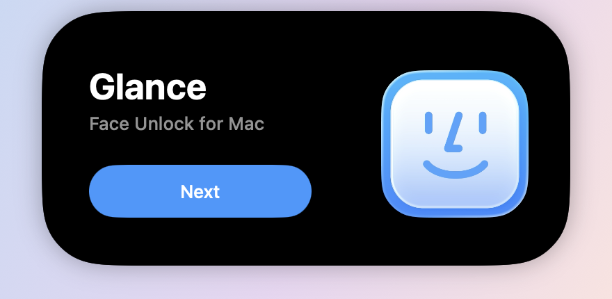
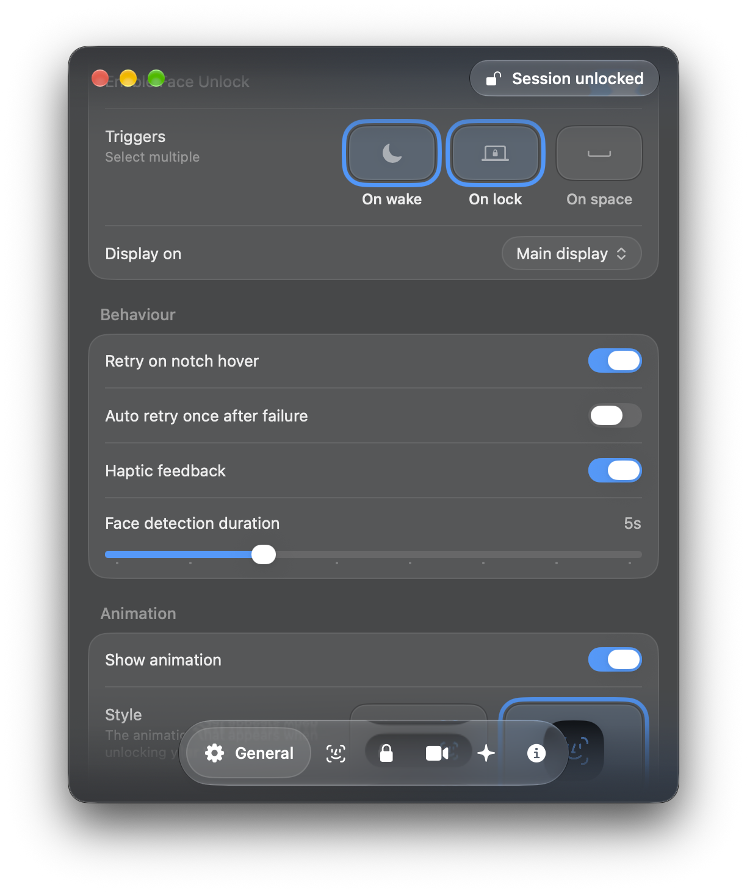
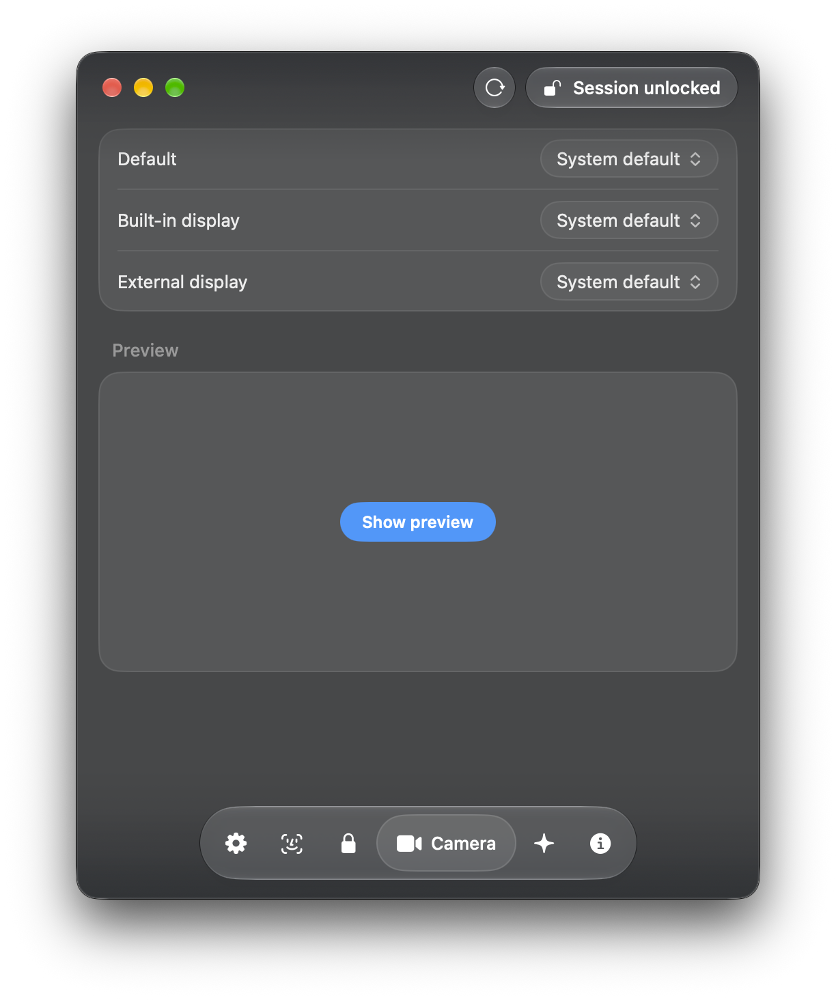

<h1 align="center">
  <br>
  Glance
</h1>

<p align="center">Face unlock for Mac.</p>

<p align="center"><sub>A fork of <a href="https://github.com/jonnyoo/glance">jonnyoo/glance</a> by Jonathan Zhou.</sub></p>

<table>
  <tr>
    <td align="center"></td>
    <td align="center"></td>
    <td align="center"></td>
  </tr>
  <tr>
    <td align="center"></td>
    <td align="center"></td>
    <td align="center"></td>
  </tr>
</table>

<sub>The island backgrounds are illustrative; the overlay is the real app.</sub>

> [!WARNING]
> Glance is not as secure as Face ID or Touch ID. A MacBook has no depth sensor, only a flat 2D camera.
>
> - With Heavy liveness on, it stops printed photos and photos on a phone screen. It does not reliably stop a video of you.
> - macOS has no API for a third-party app to authorize a login, so Glance unlocks by typing your stored password on the lock screen.
>
> It is a convenience, not a security upgrade. Use it only if you accept that.

## Install

Requires macOS 27 and an Apple silicon Mac.

[Download Glance.dmg](https://github.com/karimbacchus/glance/releases/latest/download/Glance.dmg), open it, and drag Glance to Applications.

Updating from a version before 1.3 requires re-enrolling your face, because the recognition model changed.

New in 1.3:

- Native Dynamic Island support. *Minimal* docks beside macOS's camera indicator; *original* hangs below it.
- Liquid Glass Settings.
- Lens smudge hints in the camera preview and during enrollment.
- ArcFace ResNet-50 replaces MobileFaceNet for recognition.
- Glance asks for Touch ID once at launch to unlock its session.

## Permissions

- **Camera**: to see your face.
- **Accessibility**: to type your password at the lock screen.
- **Touch ID**: to release the key that encrypts your face data and password.

## How it works

- Enrollment captures nine head poses. Each frame becomes a 512-number embedding from InsightFace ArcFace `w600k_r50`, run through Core ML. The images are discarded.
- Embeddings and your password are encrypted with AES-GCM. The key is in the keychain behind Touch ID, and is held in memory only while the session is unlocked. The session locks again after an idle period you choose.
- An unlock needs all of: an unlocked session, a locked screen, an enabled identity matching above the similarity threshold, and passing liveness.
- Everything runs on-device. Nothing is sent to a server.

### Liveness

Cues are scored over a rolling window of about two seconds.

- **Deny cues** fail the scan outright: screen glare, or a device-shaped rectangle around the face.
- **Confirm cues** (Heavy only) count as evidence of a real face: 3D landmark geometry, nose parallax across head turns, blinks. Missing one is not a failure.
- Light uses deny cues only. Heavy uses both.

## Features

- Notch and Dynamic Island overlay. Macs with neither get a floating pill.
- Triggers: wake, lock, or space at the lock screen, in any combination.
- Multiple identities, each switchable off without deleting.
- Camera choice per display, including a different camera for an external monitor.

Face Lab is a hidden debug console for recognition and liveness: Settings → About, then click the app icon 5 times.

## Build from source

Needs Xcode 27+ and the macOS 27 SDK.

```bash
git clone https://github.com/karimbacchus/glance.git
cd glance
open glance.xcodeproj
```

The project signs with the fork owner's Developer ID team and a provisioning profile named "Glance", so it will not build as-is. Set your own team, bundle identifier and profile. A profile is required because the app uses keychain access groups.

## Feedback

Use this fork's [GitHub Issues](https://github.com/karimbacchus/glance/issues).

## Credits

- [Jonathan Zhou](https://github.com/jonnyoo/glance): original Glance.
- [InsightFace](https://github.com/deepinsight/insightface): ArcFace. Its pretrained models are for non-commercial research use only.
- [The Boring Notch](https://github.com/TheBoredTeam/boring.notch): notch window physics.
- [Alcove](https://tryalcove.com): design inspiration.

## License

[MIT](LICENSE) © Jonathan Zhou
