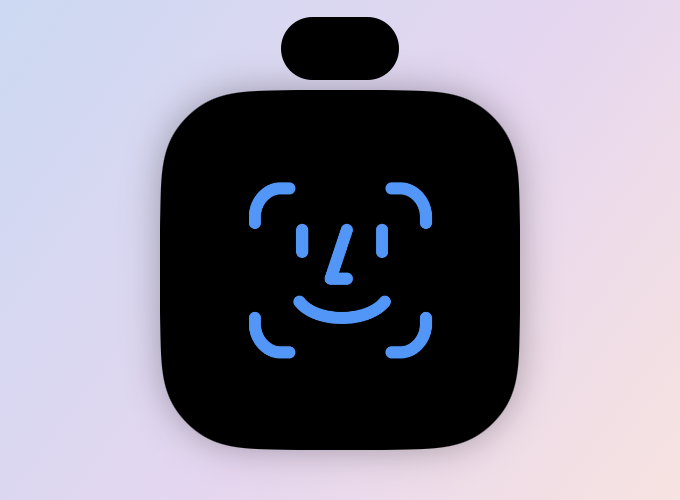
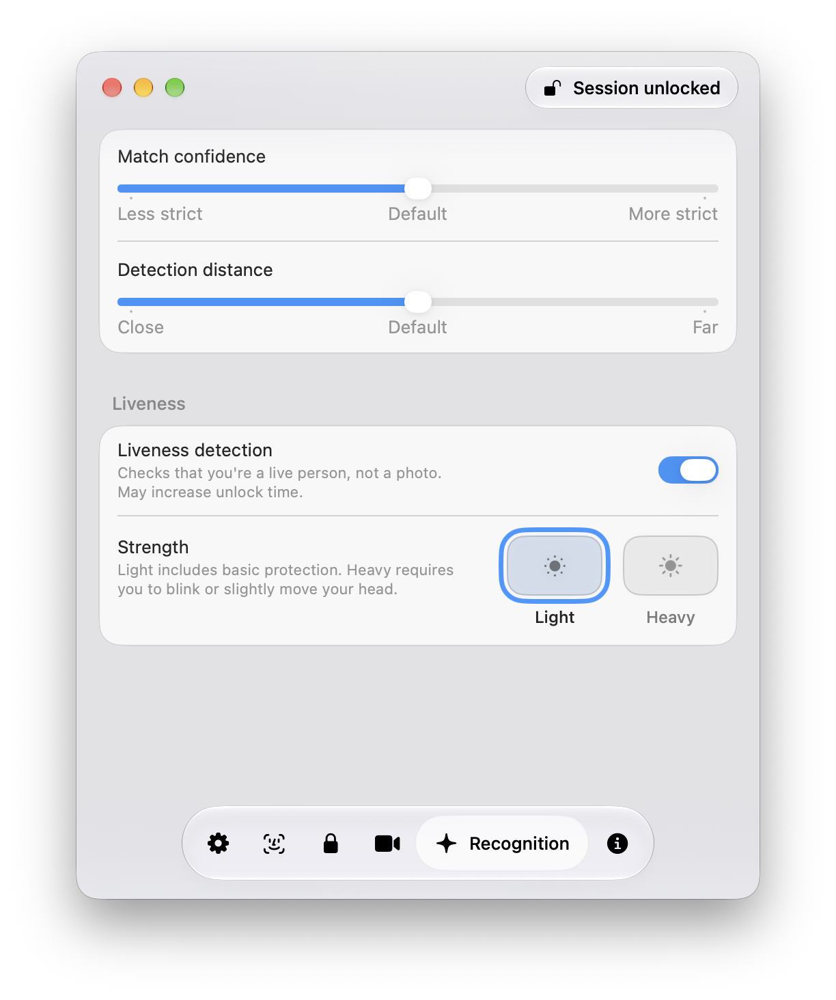

<h1 align="center">
  <br>
  <a href="https://tryglance.app"></a>
  <br>
  Glance
  <br>
</h1>

<h3 align="center">Face unlock for your Mac</h3>

<p align="center">
  <sub>A fork of <a href="https://github.com/jonnyoo/glance">jonnyoo/glance</a> by Jonathan Zhou, maintained by Karim Bacchus. Not the official Glance.</sub>
</p>

<p align="center">
  <a href="LICENSE"></a>
  
  
</p>

Glance brings the FaceID-like experience of your iPhone to a Mac near you. Unlock your Mac with a glance — no typing, no reaching for the TouchID key. Everything runs on-device using Apple's Vision
and Core ML frameworks, so your face data and your Mac password never touch the internet. The UI is built into your Macbook's notch or Dynamic Island with fluid animations.


https://github.com/user-attachments/assets/77438826-80a9-4ab2-9fc3-42407a2d0adb


---

## What's new in 1.3

This fork's 1.3 release targets macOS 27 and reworks the unlock overlay, Settings and the recognition model.

<table>
  <tr>
    <td align="center" valign="top"><br><sub><b>Minimal</b> docks beside the camera indicator</sub></td>
    <td align="center" valign="top"><br><sub><b>Original</b> hangs just below the island</sub></td>
  </tr>
</table>

<sub>The island and background in these images are drawn for illustration; the overlay is the real app.</sub>

- **Native Dynamic Island support.** Glance rests invisibly on the hardware island. The *minimal* style docks beside macOS's camera-in-use indicator, and the *original* style hangs just below the island. On touchscreen Macs, tap the overlay to retry.
- **Liquid Glass Settings.** The header controls and tab bar are glass, and rows scroll underneath them.
- **Lens smudge hints.** The Settings camera preview and enrollment tell you when the lens looks dirty, using Vision's lens smudge detection.
- **Stronger recognition.** InsightFace ArcFace ResNet-50 (`w600k_r50`) replaces MobileFaceNet, and face detection moves to Vision revision 4.
- **Faster launch.** The model loads once, off the main thread.
- **Accessibility.** Reduce Motion is respected, and "Remove password" is reachable with VoiceOver.
- **Fixes.** The app icon is now included in source builds, and recognition defaults match the sliders.

> [!IMPORTANT]
> Updating from an earlier version requires **re-enrolling your face**. The recognition model changed, so existing embeddings are not compatible.

<table>
  <tr>
    <td align="center" valign="top"></td>
    <td align="center" valign="top"></td>
    <td align="center" valign="top"></td>
  </tr>
</table>

<p align="center">
  
</p>

---

> [!WARNING]
> ## Read before downloading
> ## Glance is not as secure as Apple's FaceID or TouchID
> 
> MacBooks don't come equipped with the depth sensors that make iPhone FaceID trustworthy and secure. An
> iPhone builds a 3D map of your face; a MacBook webcam sees a flat 2D image. That means:
> 
> - Glance defeats, with reasonable confidence, a printed photo and a photo on a phone screen (heavy liveness detection must be turned on)
> - Glance does not reliably defeat a video of you
> - macOS has no API that lets a third-party app authorize a login, so Glance unlocks by typing
>   your stored password on the lock screen
> 
> Glance is a convenience feature, not a security upgrade. Only continue if you accept the tradeoff.

## Installation

**Requirements:**
- macOS 27 or later
- A Mac with Apple silicon (macOS 27 no longer runs on Intel Macs)

<a href="https://github.com/karimbacchus/glance/releases/latest/download/Glance.dmg" target="_self"></a>

Open the `.dmg` file and drag Glance to `/Applications`, then open it.


## Permissions

| Permission | Why |
|---|---|
| **Camera** | To see your face. Frames are processed in memory and never written to disk. |
| **Accessibility** | To type your password into the lock screen. |
| **Touch ID** | Gates the key that encrypts your face data and password. |

## How it works

1. Launch the app and follow the onboarding to enroll your face. Glance guides you through capturing your face, turning your head in nine
   directions. Each frame becomes a 512-number *embedding* — a mathematical fingerprint — and the
   image is thrown away.
2. Enter your Mac password once, encrypted behind Touch ID.
3. When your Mac locks or wakes from sleep, the animation appears in the notch and starts searching for a face.
4. If it's you — and the liveness checks agree you're a real person — Glance types the
   password and you're in.

## Features

| Feature | Description |
|---|---|
| **Face unlock** | Triggers on wake, on lock, or on pressing space at the lock screen. Pick any combination. |
| **Multiple identities** | Enroll several people, or several versions of yourself — with glasses, a beard, different lighting. Toggle any of them off without deleting. |
| **Liveness checks** | Watches for the motion and reflections that separate a real face from a photo. *Light* or *Heavy* strictness, or off. |
| **Notch and Dynamic Island UI** | On notched Macs, a closed pill that expands into a scan animation with success and failure states. On Dynamic Island Macs, it rests invisibly on the hardware island: *minimal* docks beside the camera indicator, *original* hangs just below. Hover (or tap, on touchscreens) to retry — or turn animations off entirely and Glance stays invisible. |
| **Camera & display** | Choose which camera to use, including different cameras for the built-in display vs. an external monitor. |
| **Auto-locking sessions** | The Touch ID session re-locks itself after an idle period you choose, so an unattended Mac doesn't stay authorized forever. |
| **Liquid Glass Settings** | Glass header and tab bar on macOS 27, in light and dark appearances. |
| **Lens smudge hints** | Warns you in the camera preview and during enrollment when the lens needs wiping. |
| **Trackpad haptics** | Hovering over the notch will trigger haptics |
| **Notchless Mac support** | Macs with neither a notch nor an island get a floating pill-shaped, Dynamic Island style overlay. |
| **Your data, your call** | Edit or delete your enrolment or stored password at any time. The encrypted files are removed immediately. |

---

# Privacy and Security

Glance is designed to keep biometric data and credentials on-device.

### Face data

Glance never stores camera images. During enrollment, each captured face is converted into a **512-dimensional embedding** using the InsightFace **ArcFace `w600k_r50`** (ResNet-50) model, run through Core ML. The original frame is then discarded.

Embeddings are stored locally and encrypted with **AES-GCM**.

### Credentials

Your Mac password is stored as encrypted data and is never written to disk in plaintext. The encryption key is a **256-bit AES key stored in the macOS Keychain**, protected by `userPresence` — requiring Touch ID or your device password.

The key is only held in memory while an authorized Glance session is active.

### Unlock pipeline

Glance won't type your password simply because a face matches. An unlock requires all of the following:

1. A valid Glance session is authorized.
2. The Mac is actually at the lock screen.
3. An enabled identity matches above the configured similarity threshold.
4. Liveness checks accept the detected face.
5. Accessibility permission is available to enter the password.

Face recognition and liveness detection run independently and must both succeed before the password is entered. 

### Local by design

Face recognition, face enrollment, and liveness detection run entirely on-device using Vision and Core ML. Glance does not send face data, camera frames, or credentials to a server.


### How it tells a face from a photo

Five independent cues over a rolling ~2s window, in two roles:

- **Deny cues** are evidence of a spoof — screen glare, or a device-shaped rectangle framing the
face. Either one fails the scan outright and overrides anything else.
- **Confirm cues** are evidence of a real face — flat-vs-3D landmark geometry, nose parallax
across head turns, blinks. Any one is enough, and their absence is never a failure, since a
live person can sit still and not blink.

Light detection only include deny cues. Heavy detection includes both deny and confirm cues.

### Face Lab

Face Lab is a hidden debug console to test face recognition and liveness detection with real values.

**To open it:** Settings → About, then click the app icon 5 times. A
debug section should appear in the sidebar.

---


## Building from source

### Prerequisites

- macOS 27+
- Xcode 27+ with the macOS 27 SDK


### Installation

1. Clone repository:
  ```bash
   git clone https://github.com/karimbacchus/glance.git
   cd glance
  ```
2. Open in Xcode:
  ```bash
   open glance.xcodeproj
  ```
3. Set up signing. The project is configured to sign with the fork owner's Developer ID team and a provisioning profile named
   "Glance", so it will not build for you as-is. In the target's *Signing & Capabilities*, set your own team, change the
   bundle identifier (currently `com.karimbacchus.glance`) to one you own, and use your own provisioning profile. A profile is
   required because the app uses keychain access groups.
4. Run the project:
  - Click `run` or press `Cmd + R`.


## Contributing

Not currently accepting PRs. Feel free to fork this project.

Bug reports and feedback for this fork go to [GitHub Issues](https://github.com/karimbacchus/glance/issues). For the original
project, see [jonnyoo/glance](https://github.com/jonnyoo/glance) and [tryglance.app/feedback](https://tryglance.app/feedback).

## Acknowledgements

- **[The Boring Notch](https://github.com/TheBoredTeam/boring.notch)** — for the notch window
physics.
- **[InsightFace](https://github.com/deepinsight/insightface)** — the ArcFace model doing the
recognition. InsightFace's pretrained models are released for non-commercial research use only; keep that in mind before
redistributing or commercializing builds of Glance.
- **[Jonathan Zhou](https://github.com/jonnyoo/glance)** — the original Glance, which this fork builds on.
- **[Alcove](https://tryalcove.com)** — big design inspiration.


## License

[MIT](LICENSE) © Jonathan Zhou
